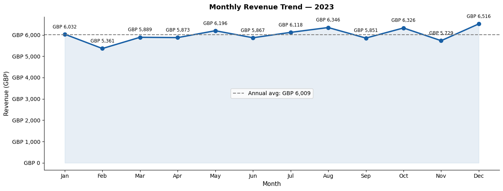
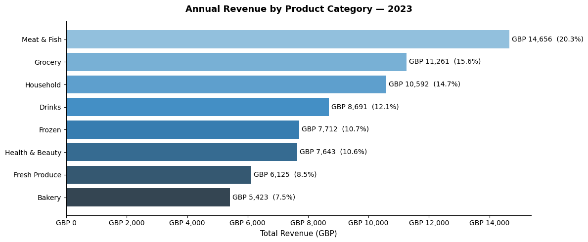
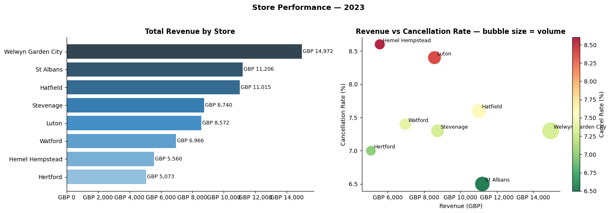

# Retail Store Productivity Analysis (Tesco-style, simulated data)

> **Simulated data.** I generated all 15,000 transactions myself to model a year of trading across 8 Hertfordshire supermarkets. It is **not real Tesco data**, and this project is not affiliated with Tesco. The store names, categories and Clubcard field are there to make the scenario feel like the stores I worked in.

## The business question

**Where is a supermarket network losing revenue, and what should store operations plan around?**

I answer it in five parts: which categories drive revenue, how sales move through the year, where cancellations happen, which stores and customers matter most, and which days trade strongest.

## What I found

| | Result (full year 2023, simulated) |
|---|---|
| **Revenue** | £72,103 from 13,882 fulfilled orders; average order £5.19 |
| **Seasonality** | December is the peak (£6,516) and February the low (£5,361): a 1.22× swing around a £6,009 monthly average |
| **Cancellations** | 7.5% of orders (1,118) were cancelled. Health & Beauty is worst at 10.0%, then Meat & Fish 9.5% and Household 8.8% |
| **Top category** | Meat & Fish brings in 20.3% of revenue, so it is both the biggest earner and the second-worst for cancellations |
| **Stores** | Welwyn Garden City leads on revenue (£14,972). Hemel Hempstead (8.6%) and Luton (8.4%) have the highest cancellation rates; St Albans the lowest (6.5%) |
| **Customers** | The top 10% of customers bring in 22.4% of revenue |
| **Clubcard** | Members spend only 1.4% more per order (£5.22 vs £5.15), so loyalty status alone barely changes basket size |
| **Days** | Sunday is the strongest trading day; Friday the weakest |

**What I'd recommend:** fix availability in Meat & Fish first, because it combines high revenue with a high cancellation rate. Review fulfilment at Hemel Hempstead and Luton using St Albans as the benchmark. Plan stock build and staffing around December and weekends, and use promotions to lift February.



<details>
<summary>More charts</summary>




</details>

## Stack

Python (pandas, NumPy, Matplotlib, seaborn) in a Jupyter notebook · a standalone HTML dashboard built with Chart.js

## What's in the repo

| Path | What it is |
|---|---|
| `tesco_retail_analysis.ipynb` | The full analysis in 11 sections, from loading and cleaning to recommendations |
| `data/tesco_retail_data.csv` | The simulated dataset: 15,000 rows, 12 columns (transaction, date, store, customer, product, category, quantity, price, amount, status, payment method, Clubcard) |
| `tesco_analytics_dashboard.html` | Interactive dashboard; open it in any browser |
| `images/` | Charts exported from the notebook |

## How to run it

```bash
git clone https://github.com/PraneetSivakumar/Tesco-Retail-Analysis.git
cd Tesco-Retail-Analysis
pip install pandas numpy matplotlib seaborn jupyter
jupyter notebook tesco_retail_analysis.ipynb
```

Then choose **Kernel → Restart & Run All**.

## Known issues (being fixed)

- The "estimated revenue lost to cancellations" figure in section 7 comes out blank because of an index mismatch in the code, so I do not quote it above.
- Some figures hard-coded in the HTML dashboard (for example the Clubcard uplift and the monthly bars) do not yet match the notebook. **Trust the notebook numbers.**

## Contact

**Praneet Sivakumar** · MSc Data Science (Distinction), University of Hertfordshire
[LinkedIn](https://www.linkedin.com/in/praneetsivakumar) · [Portfolio](https://www.praneetsivakumar.com) · connect.with.praneet@gmail.com
